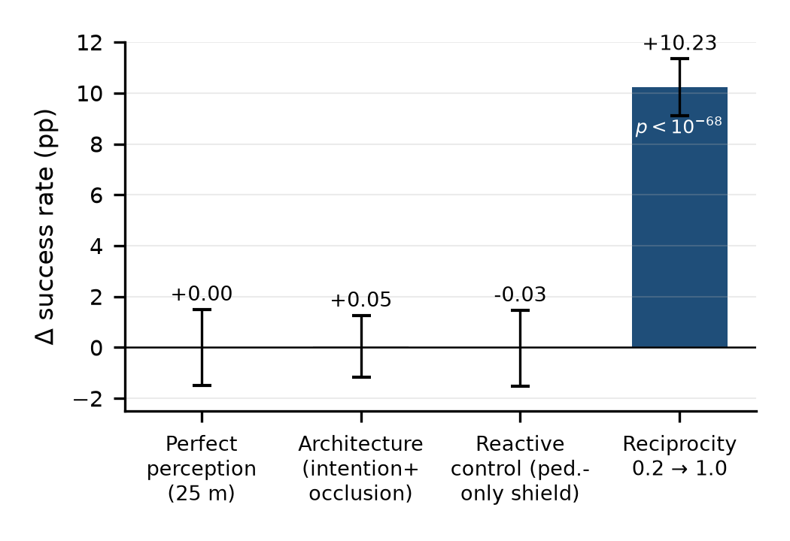
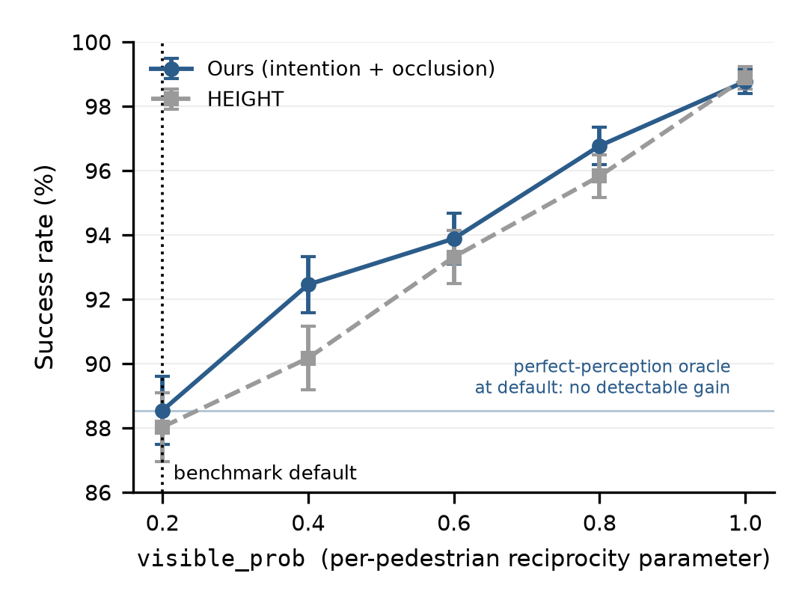
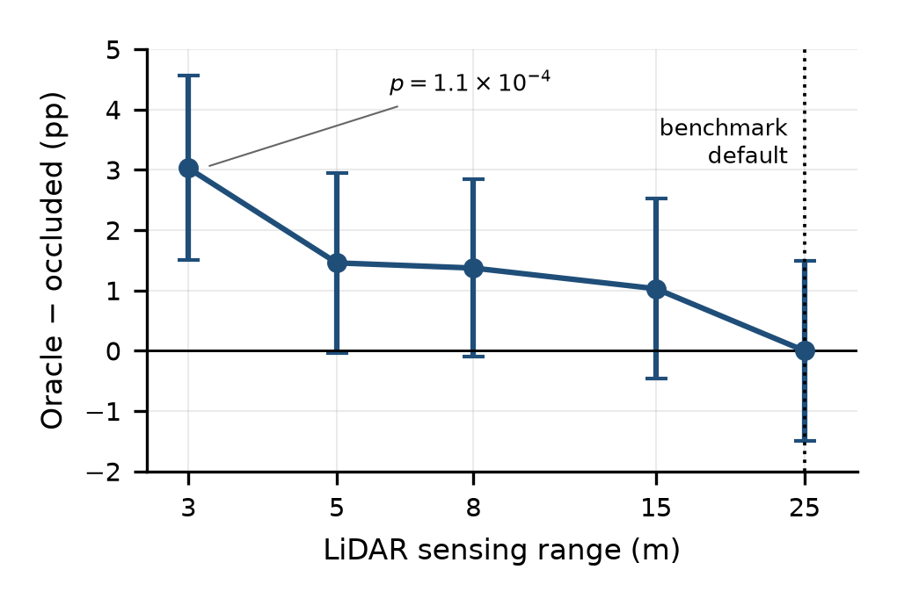
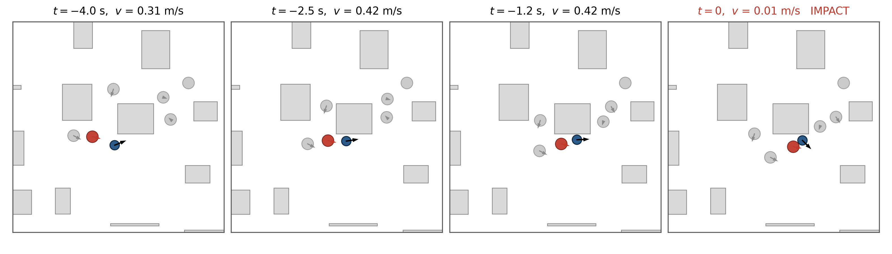
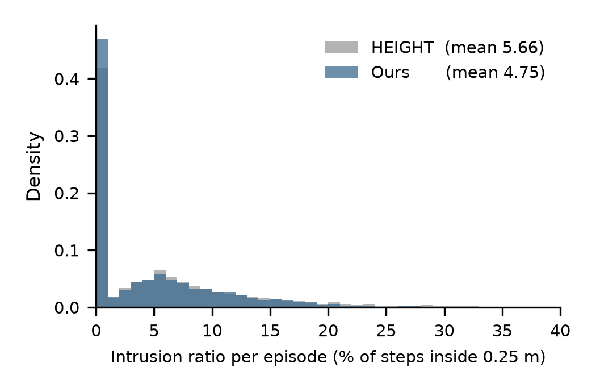

# HEIGHT Benchmark Analysis

Code, evaluation logs and trajectory data for a study of what the HEIGHT crowd-navigation
benchmark actually measures.

The short version: we set out to improve HEIGHT by adding intention prediction and
occlusion inference, and we did not succeed. Working out why turned into the study in this
repository. For the checkpoints we tested, success responds strongly to one simulator
setting, `robot.visible_prob`, which decides what fraction of simulated pedestrians are
allowed to perceive the robot at all. It is fixed at 0.2 in every published result we are
aware of. Sweeping it moves success from 88.5 percent to 98.8 percent. The three
interventions we tried on the robot's side of the interaction, and a 75 percent increase
in the baseline's training, did not improve success measurably at the default setting.

Everything here is at n = 3,500 test episodes unless stated otherwise. Every statistic and
figure in the paper is regenerated by `stats/paper3_stats.py` and `stats/paper3_figures.py`
from the inputs in this repository, with the SHA-256 of each input recorded.

---

## The result in one figure



The three interventions we tested on the robot's side of the interaction change success
rate by no detectable amount at the benchmark's default setting. One change on the
pedestrians' side moves it by ten points.

---

## What we measured

| Intervention | Effect on success rate |
| --- | --- |
| Oracle perception: every pedestrian visible, 25 m sensor | 3,099 vs 3,099 successes (216 episodes succeed only with the oracle, 216 only without) |
| Added architecture: intention prediction plus occlusion inference, 3 seeds | 88.08 +/- 0.49 % vs 88.03 %, t = 0.17, df = 2 |
| Pedestrian-only rollout shield (obstacles and walls not scored), both architectures | no detectable change; pedestrian collisions fell and obstacle collisions rose (see the shield note) |
| Same architecture retrained without privileged futures, 3 seeds at 350 M steps | 88.07 +/- 0.90 %, no seed different from either baseline |
| 75 % more training compute for the baseline (199.8 M to 350 M steps) | 87.77 % vs 88.03 %, p = 0.74 |
| **Pedestrian reciprocity swept 0.2 to 1.0** | **88.5 % to 98.8 %, p < 1e-68** |

### Reciprocity strongly changes success in this sweep



Success rises monotonically with the fraction of pedestrians able to perceive the robot,
for both architectures. The gap between the two architectures closes to 0.11 points at the
top of the range.

### Perfect perception gives this checkpoint no detectable success gain at the default sensing range



The oracle's gain shrinks as the sensing range grows and is not detectable at the
benchmark's default 25 m, where the totals are equal but 216 episodes succeed only with the
oracle and 216 only without it. Only the 3 m cell (+3.03 points) is significant after
correcting for five tests; the decay itself rests on the monotone shape of the whole sweep.

### Where the collisions actually come from



Of 336 pedestrian collisions in the primary trajectory dump, 335 involve a pedestrian
configured to be unable to perceive the robot, against a base rate of 82.4 percent
(z = 8.33, Cohen's h = 0.76). A repeat evaluation of the same checkpoint gives 347 of 348;
it uses the same evaluation seed, so it is a rerun check rather than an independent sample
of scenarios. The panels above are one selected example with strong braking: a pedestrian
on a nearly straight heading that cannot see the robot, and a robot whose recorded speed
falls from 0.42 to 0.01 m/s before it is struck from the side. Across all 336 collisions
the recorded speed trends are mixed: over the final half second, with a tolerance of
+/-0.005 m/s, speed fell in 171, rose in 136 and stayed within the tolerance in 29.

The colliding pedestrian's approach direction (its own velocity against the
robot-to-pedestrian bearing; the robot's velocity is not subtracted) is oncoming in 72.9
percent of cases, crossing in 23.2, receding in 3.0, and stationary in 0.9 (three
pedestrians with zero recorded speed). Earlier versions called this axis "relative motion"
and assigned the stationary cases by bearing alone (73.5 / 23.2 / 3.3 percent).

### An intrusion gain that needs privileged input



With ground-truth pedestrian futures as input, seed 1 of the augmented system spends 16.1
percent fewer timesteps inside HEIGHT's 0.25 m discomfort zone than the released
checkpoint, and 11.4 percent fewer than the baseline fine-tuned to 350 M steps (Welch
p = 8.2e-5), at matched success and similar navigation time. Seeds 2 and 3 logged intrusion
ratios 12.9 and 3.2 percent below that baseline; their per-episode data were not kept, so
only seed 1 is tested. Retrained without those futures for the same
350 M steps, none of three seeds intrudes significantly less than that baseline (-4.6, -2.7
and -2.0 percent; p = 0.13, 0.37, 0.51). No gain is therefore detected from the
architecture at matched compute. All three point estimates favour the augmented system, so
a smaller effect is not excluded.

---

## Repository layout

```
code/          analysis scripts and experiment launchers
source/        the modified HEIGHT tree with documented post-run fixes
configs/runs/  snapshot configuration of each trained or evaluated run
checkpoints/   trained weights behind every result, and the released HEIGHT checkpoint
results/logs/  every retained evaluation log and per-episode JSON (historical, unchanged)
results/v2/    versioned re-analyses of 13 Oct 2026 (inevitable-collision search v2)
results/runtime/  the observed package listing; capture/run association unestablished
data/          the two trajectory dumps used for the collision analyses
stats/         the statistics and figure driver, and its outputs
tests/         fixtures for the code changes of 13 Oct 2026
figures/       figures as published
```

### code/

Analysis, run directly on a trajectory dump or a log directory:

| File | Purpose |
| --- | --- |
| `collision_taxonomy.py` | v1, historical: classifies each collision by reactivity, impact bearing, pedestrian heading class and robot speed; reproduces `collision_taxonomy_n3500.log` |
| `collision_taxonomy_v2.py` | v2: the same axes with the heading class renamed "pedestrian approach direction" and a stationary class; the paper's Table VII |
| `taxonomy_sensitivity.py` | attribution sensitivity (what if a second pedestrian was nearly as close) and heading-change threshold sweep |
| `responsibility.py` | conflict-reduction responsibility shares after Wenzel and Probst, a geometric score (see Known issues) |
| `ics_analysis.py` | v1, historical: backward search for inevitable collision states; reproduces `ics_exact_results.txt` and `ics_full_results.json` |
| `ics_analysis_v2.py` | v2: the same search over the closed window [t0, t0+k], with exported and replayed witness sequences; the paper's Table IV |
| `analyze_nopredict.py` | self-interpreting report for the deployable arm: per-seed tests, compute-matched comparison, verdict |
| `cbf_filter.py` | the rollout shield applied to a frozen policy, in the spirit of control barrier functions; pedestrian-only by default |
| `evaluation.py` | the modified evaluation harness: per-episode social metrics and the trajectory dump (the same file as `source/training/evaluation.py`) |
| `prepare_reproduction_run.py` | creates isolated shield-reproduction configs and links original weights without changing them |
| `set_config_value.py` | edits a single key in a run's snapshot configuration |

Experiment launchers, written for a single-GPU node with tmux:

| File | Purpose |
| --- | --- |
| `run_experiment.sh` | the common launcher every training arm calls |
| `nopredict_350M.sh` | the deployable arm: three seeds, 350 M steps, no privileged futures |
| `height_ft150.sh` | fine-tunes the released baseline to 350 M steps as a compute-matched control |
| `recip_endpoints.sh`, `reciprocity_sweep.sh` | the reciprocity sweeps |
| `range_confirm.sh`, `tier2_chain.sh` | the sensing-range and oracle sweeps |
| `cbf_2x2.sh` | the reported shield 2x2; since 13 Oct it sets and asserts `cbf.obstacles=False` along with every other shield flag |
| `cbf_sweep.sh` | an obstacle-aware sweep of which only the shield-off control cell ever ran |
| `ics_boost.sh` | regenerates the trajectory dump and runs every dump analysis |
| `baseline_table.sh` | reproduces the released checkpoints |
| `social_metrics.sh` | the social-metric comparison |
| `height_pristine.sh` | an attempt to run the benchmark in a pristine environment, retained because the paper reports it as a reproducibility result |

Each launcher writes a snapshot configuration, asserts every key it depends on before
committing GPU time, and aborts loudly on a mismatch. That pattern exists because an early
run in this project trained on the wrong budget for four days before anyone noticed.

### results/logs/

Evaluation logs are plain text from the harness; each ends with a summary line giving the
success count, navigation time and path length. Files named `intrusion_test_<run>.json`
hold per-episode social metrics: the intrusion ratio for every one of the 3,500 episodes,
per-event intrusion depths, episode-worst separations and path lengths. Path length,
separation and depth carry the automatic-reset artefact described under Known issues; the
intrusion ratio and the outcome counts do not.

The deployable arm is `eval_exp_nopredict_s{1,2,3}.log`, `intrusion_test_exp_nopredict_s{1,2,3}.json`
and `exp_nopredict_s{1,2,3}_train.log`; `NOPREDICT_REPORT.txt` is the analyser's output on
them. The `*_50000000steps_archived_*` training logs are aborted launches on the wrong
budget and are kept only as a record. `eval_traj_nospeak.log` (added 13 Oct, byte-identical
to the archived copy) is the eighth default-configuration evaluation of seed 1 behind the
paper's run-to-run variation figures.

Naming follows the experiment: `rc_*` sensing range, `re_*` reciprocity at n = 3,500,
`rp_*` reciprocity pilot at n = 1,000, `rs_*` range pilot, `base_*` released-checkpoint
reproduction, `gen_*` distribution shifts, `x_*` the shield 2x2, `cbf_*` its n = 1,000 pilot,
`soc_*` social metrics, `ics_redump_*` the analyses of the corrected trajectory dump.
Training logs are `*_train.log`. The `ics_redump_pad*_b*.log` files come from an earlier
beam-search version of the inevitable-collision analysis and are superseded;
`ics_exact_results.txt` and `ics_full_results.json` are the v1 exhaustive search, kept
unchanged. The paper reports the v2 search in `results/v2/`.

`stage2_train_log.txt` is included because it is the provenance for the training-budget
figures reported in the paper. Reading the update counter across its restarts is how the
total was reconstructed.

### data/

`trajectories_n3500.tar.gz` is the primary dump: 780 pickled per-episode records from one
evaluation of the frozen seed-1 policy, every collision plus every eighth success as a
control set. Each record holds the outcome, the robot radius and kinematic limits, the
static obstacle geometry for that episode, and a per-timestep list of robot pose and
velocity together with every pedestrian's position, velocity, radius and reactivity flag.

```python
import pickle
d = pickle.load(open('ep_01485.pkl', 'rb'))
d['outcome']             # ReachGoal, CollisionHuman, CollisionObs, CollisionWall
d['obstacle_vertices']   # world-frame rectangle vertices for this episode
for step in d['steps']:
    t, rx, ry, rvx, rvy, rtheta, humans = step
    for hx, hy, hvx, hvy, radius, reacts_to_robot in humans:
        pass
```

`trajectories_n3500_repeat.tar.gz` holds 805 records in the same format from a repeat
evaluation of the same checkpoint with the same evaluation seed. The paper uses it for the
repeat-evaluation checks of the taxonomy, the attribution sensitivity and the
responsibility score.

One caution on the repeat dump. It was written by an earlier version of the evaluation
harness, which read the obstacle geometry after the episode loop had ended; the vectorised
environment auto-resets on termination, so its recorded geometry belongs to the following
episode. Use it only for quantities that do not involve obstacles, and never for the
inevitable-collision search. The primary dump is from the corrected harness: no recorded
robot position falls inside any recorded obstacle across all 122,200 timesteps, and
obstacle contacts register at a median of 2.6 cm beyond the robot radius.

---

## Statistics and figures

`stats/paper3_stats.py` recomputes every statistic the paper prints, from the logs, the
per-episode JSON arrays, the two trajectory dumps and `results/v2/`, and writes
`stats/outputs/v2_2026-10-13/paper3_stats.json` and the adjacent `paper3_stats.md`. The JSON records the complete results and input hashes; the Markdown provides selected readable tables. Both identify cohorts and test designs.
`stats/paper3_figures.py` draws the four paper figures from that JSON (the collision
example from the primary dump) into `stats/outputs/v2_2026-10-13/figures/`. The procedures are in
`stats/statlib.py`: two-proportion z (pooled for p, unpooled 95% CI) for success rates;
Welch t with an exact t tail for per-episode metrics; exact McNemar and paired t for
episode-index-matched contrasts within one checkpoint; Wilson intervals; Mann-Whitney with
tie correction and Cliff's delta. Contrasts across checkpoints are unpaired, because the
two systems were evaluated under different environment seeds (1-3 and 50569). Pairing
within a checkpoint rests on the shared seed/index reset design; initial-scene hashes were
not archived. The TOST (margin 1.1 points) and the shield's per-collision-type tests are
exploratory and labelled so.

```bash
python3 -B stats/paper3_stats.py        # about four minutes on a laptop CPU
python3 -B stats/paper3_figures.py
```

The defaults generate versioned outputs. Earlier `stats/outputs/paper3_stats.*` and
`stats/outputs/figures/` are retained from the first implementation run, not the current
source-bound generator outputs. Use `--out` to select another statistics output directory;
`paper3_figures.py --stats <json> --out <directory>` selects its source and destination.
When `--primary` or `--repeat` supplies an extracted directory, every payload is checked
against the corresponding hashed archive before analysis. A missing, extra or changed
payload fails rather than attributing unrelated data to that archive. The JSON includes
complete shield transition matrices and discordant IDs; initial-scene pairing remains a
conditional inference from archived seeds and episode indices.

Two printouts of the historical scripts differ from the paper by design:
`responsibility.py` prints its control test with a normal approximation (p = 0.0141, CI
[+0.012, +0.103]), while the paper and the driver give the exact Welch t on the same arrays
(p = 0.0146, CI [+0.011, +0.103]); and `ics_analysis.py` (v1) prints the open-start
fractions described in the note below.

---

## Reproducing the analysis

The analysis scripts need Python 3 with NumPy; the figures also need matplotlib. They do
not need a GPU, PyTorch or the simulator.

```bash
mkdir -p /tmp/traj
tar xzf data/trajectories_n3500.tar.gz -C /tmp/traj

python3 code/collision_taxonomy_v2.py /tmp/traj
python3 code/taxonomy_sensitivity.py  /tmp/traj
python3 code/responsibility.py        /tmp/traj

python3 code/ics_analysis_v2.py /tmp/traj --pad 0.049 --out ics_v2_pad0.049.json
python3 code/ics_analysis_v2.py /tmp/traj --pad 0.049 --eligibility per-horizon --out ics_v2_386.json
ICS_PAD=0.049 python3 code/ics_analysis.py /tmp/traj      # v1, historical
```

The inevitable-collision search takes between two and twenty-five minutes per padding
value on a laptop CPU, longest at the largest padding. `tests/` holds fixtures for every
code change of 13 Oct 2026; each runs as `python3 tests/<file>.py`, and
`tests/compare_ics_v1_v2.py` compares every v1 and v2 search verdict (the stored comparison
is `results/v2/ics_v1_v2_comparison.json`).

---

## A note on the inevitable-collision analysis

The search asks, for each recorded collision, whether any sequence of the robot's nine
discrete actions stays clear from the state the robot occupied k steps before impact
through the recorded moment of contact, while the pedestrians replay their recorded paths.
It is depth-first and cuts no branch, but it merges states that fall in the same quantised
cell (2 cm, 0.1 rad), so an "inevitable" verdict is exhaustive only up to that
quantisation. The robot follows its commanded unicycle kinematics rather than the
simulator's saturating wheel model, the arena wall is not modelled, and the window ends at
the recorded contact. Read the numbers as finite-window, nominal-model estimates, not
certified inevitable-collision states in the sense of Fraichard and Asama.

Version 2 (`ics_analysis_v2.py`, 13 Oct 2026) tests the start state with the same human and
rectangle predicates before searching, so a start already inside the (padded) contact
envelope counts as no escape; v1 tested only the later samples, and returned True for a zero
horizon. v2 also returns each surviving action sequence and replays it without merging
(no replay has failed), and reports aborted searches instead of dropping them (none
aborted). Every other verdict is identical: across 1,173 episode-horizon pairs per padding
value, v1 and v2 differ only at seven start states, all already inside the padded envelope
(4.9 cm: episodes 1095 and 1418 at 1 s, 2113 and 2460 at 2 s; 10 cm: 2012 at 0.5 s, 973 at
1 s, 362 at 2 s). At 4.9 cm, 14-19 starts per look-back are inside the envelope, mostly
within 4.9 cm of an obstacle rather than in recorded contact.

Over the 385 collisions whose nearest pedestrian was non-reactive (recorded robot to
pedestrian gaps at registered contact have a median of 4.9 cm beyond the sum of radii,
partly because the recorded robot pose lags the pedestrians' by one step), the fraction
with no escape is:

| Look-back before impact | pad 0 | pad 0.049 | pad 0.10 |
| --- | --- | --- | --- |
| 0.5 s | 1.6% (6) | 25.5% (98) | 69.1% (266) |
| 1.0 s | 0.8% (3) | 8.3% (32) | 26.8% (103) |
| 2.0 s | 1.0% (4) | 5.7% (22) | 12.2% (47) |

v1's figures for the same cohort were 1.6/0.8/1.0, 25.5/7.8/5.2 and 68.8/26.5/11.9
percent. Two seconds before impact, 94.3 percent of these collisions still had an action
sequence that stays clear through the moment of contact. With the padded contact models,
inevitability rises sharply in the final half second; with bare circles it stays rare.
The dependence on the contact model is intrinsic rather than a defect: an
inevitable-collision state is defined relative to the collision predicate, which is why
the band is reported instead of a single number.

The cohort is the collision records with at least 25 recorded states, the rule of the first
version (391 episodes, of which 385 have a non-reactive nearest pedestrian). It excludes one
obstacle collision with 24 states, enough for every horizon. Admitting every record with at
least k + 1 states (`--eligibility per-horizon`) gives a separate 386-case cohort: 7/3/4,
99/32/22 and 267/103/47 no-escape cases at the three paddings. The two cohorts are not mixed.

The rows are separate questions: each starts from the state the robot actually occupied
that long before impact, so nothing requires them to be ordered. The fixed-start
monotonicity self-check (the no-escape verdict must persist as the horizon grows) passes
with no violations over all 391 episodes at every padding value. Passing it is necessary,
not sufficient. An earlier clearance-ordered beam could discard surviving branches and reported inflated
no-escape fractions. A passing fixed-start check alone does not validate exhaustiveness.
Do not reintroduce pruning to make it faster.

---

## A note on the shield

The reported 2x2 (`x_{height,ours}_{off,on}.log`, run 9-10 September 2026) used the
pedestrian-only shield: `cbf_2x2.sh` set the shield's horizon (10 steps) and margin (0.10 m)
but not `cbf.obstacles`, whose default is False in both `cbf_filter.py` and the evaluation
harness, and the logs' activation banner predates the `obstacles=` field. The obstacle-aware
option was written after the last cell finished and has never been evaluated; the sweep that
would have tested it (`CBFSWEEP.log`) ran only its shield-off control and stopped at
episode 328. Within each checkpoint, shield-on and shield-off episodes are conditionally matched by the shared reset seed/index design;
full initial-scene hashes were not archived:

| | Success | Pedestrian collisions (off-only / on-only; exact McNemar p) | Obstacle collisions | Wall | Timeout |
| --- | --- | --- | --- | --- | --- |
| HEIGHT off -> on | 3,081 -> 3,065 (McNemar p = 0.45; unpaired 0.56) | 358 -> 318 (195 / 155; 0.037) | 58 -> 112 (39 / 93; 2.9e-6) | 1 -> 1 | 2 -> 4 |
| Ours seed 1 off -> on | 3,102 -> 3,101 (McNemar p = 1; unpaired 0.97) | 331 -> 295 (198 / 162; 0.065) | 62 -> 93 (49 / 80; 0.008) | 1 -> 2 | 4 -> 9 |

These per-type tests were added after the experiment and are exploratory. Over the four
pedestrian and obstacle tests, Bonferroni and Holm corrections keep the two obstacle
increases and neither pedestrian decrease. 31 HEIGHT and 34 of our episodes moved from a
pedestrian to an obstacle collision, against 11 and 11 the other way. The success null
stands, but it hides this trade. Its mechanism is not isolated: obstacle-blind substitution
is consistent with it, and forecast and rollout errors are not ruled out.

---

## Runtime environment

What is known about the environment of the reported runs, observation by observation:

1. **31 July 2026, before any reported run.** The setup notebook printed PyTorch
   2.4.0a0+f70bd71a48.nv24.06 on an H100 80GB MIG 3g.40gb partition and "gym detected:
   0.26.2".
2. **6 August and 16 September 2026.** Two tracebacks (Stage-2 data collection, and the
   pristine-clone attempt of `height_pristine.sh`) pass through
   `gym/wrappers/order_enforcing.py`, line 18, `return self.env.reset(**kwargs)`. Gym
   0.22.0 has that call at line 18; an unmodified Gym 0.26.2 has it at line 42. These
   processes therefore did not use an unmodified 0.26.2, though line 18 alone does not
   single out 0.22.0.
3. **Package listing observed on Drive with modification time 12 October 2026,
   08:46:47 UTC.** `logs/pip_freeze_dgx.txt` is archived here as
   `results/runtime/pip_freeze_dgx_20261012.txt` (SHA-256
   `98291fc71945bf15ea7595f369e3adf3ba801cdf38002020c7294f23bf1c09e4`). The metadata time
   does not establish when the command ran or which historical runs used those packages.
   The listing contains gym 0.22.0, numpy 1.24.4, pybullet 3.2.6, pyglet 1.5.27,
   PyTorch 2.4.0a0+f70bd71a48.nv24.6, Python-RVO2 at commit
   `c2c46ba8d59556aa10faf03479293236efea154d`, and an editable install of a separate
   PaS-CrowdNav checkout. The archive filename records the observation date, not a verified
   capture date.

No complete per-run package-version record was located in the reviewed material; the
versions of individual runs remain unestablished. `source/training/networks/envs.py`
contains handling for both Gym APIs (the checker is disabled, the removed seed call is
guarded, and the `baselines/` stand-in accepts four- and five-value step results).
The prepared source passed the eight-stage CPU smoke in the existing DGX runtime and in
a fresh Mac CPU environment. The Linux NVIDIA replacement recipe below remains untested.

### Verified fresh Mac CPU evaluation installation

On 13 October 2026, a new macOS **26.1 arm64** environment with managed CPython **3.10.18**
passed all eight CPU evaluation/lifecycle stages. It used stable Torch **2.4.0** and
Torchvision **0.19.0**, rather than the NVIDIA alpha Torch build observed on the DGX.
The complete 33-package freeze, resolved dependency locks, public download URLs/SHA-256s,
portable smoke procedure and neutral validation summary are in
[`code/runtime_validation/`](code/runtime_validation/README.md).

Prerequisites for this Mac recipe are native Python 3.12, Git, curl and the Apple compiler/
SDK. Run from the repository root. All installations and outputs use a new scratch folder:

```bash
HEIGHT_REPO="$PWD"
HEIGHT_CPU_WORK=$(mktemp -d)
python3.12 -m pip install --no-cache-dir --target "$HEIGHT_CPU_WORK/bootstrap" uv==0.8.22
UV_CACHE_DIR="$HEIGHT_CPU_WORK/uv-cache" "$HEIGHT_CPU_WORK/bootstrap/bin/uv" \
  --no-config --native-tls python install --no-bin \
  --install-dir "$HEIGHT_CPU_WORK/python" cpython-3.10.18-macos-aarch64-none
"$HEIGHT_CPU_WORK/python/cpython-3.10.18-macos-aarch64-none/bin/python3.10" \
  -m venv "$HEIGHT_CPU_WORK/venv"
export PATH="$HEIGHT_CPU_WORK/venv/bin:$PATH"
export PIP_CONFIG_FILE=/dev/null
python -B -m pip install --no-cache-dir -r "$HEIGHT_REPO/code/runtime_validation/cpu-build-tools.lock"
python -B "$HEIGHT_REPO/code/runtime_validation/fetch_cpu_packages.py" \
  --output "$HEIGHT_CPU_WORK/packages"
export PIP_NO_INDEX=1 PIP_FIND_LINKS="$HEIGHT_CPU_WORK/packages"
python -B -m pip install --no-cache-dir --no-build-isolation \
  -r "$HEIGHT_REPO/code/runtime_validation/cpu-dependencies.lock"
CFLAGS=-Dfdopen=fdopen ARCHFLAGS='-arch arm64' \
  python -B -m pip install --no-cache-dir --no-build-isolation pybullet==3.2.6
CMAKE_APPLE_SILICON_PROCESSOR=arm64 ARCHFLAGS='-arch arm64' \
  python -B -m pip install --no-cache-dir --no-build-isolation \
  git+https://github.com/sybrenstuvel/Python-RVO2.git@c2c46ba8d59556aa10faf03479293236efea154d
python -B -m pip check
python -B code/runtime_validation/build_smoke.py --output "$HEIGHT_CPU_WORK/artifact"
python -u -B "$HEIGHT_CPU_WORK/artifact/run_runtime_smoke.py" \
  --artifact "$HEIGHT_CPU_WORK/artifact" --scratch-parent "$HEIGHT_CPU_WORK"
```

PyBullet's build-only `fdopen` macro addresses a current Mac SDK compile failure;
RVO2 explicitly selects arm64 for its library and extension. Their upstream code/commit
and the research source are unchanged. The tested target is macOS 26.1; package filenames
containing macOS 11 are not evidence of testing on that older OS.

The smoke strictly loaded all three compatible policies and two teachers, checked actual
config/source imports and observation shapes, rehashed ten scenes, verified four normal
worker exits and completed exactly episodes 0–19 in standalone `test.py`. All input bytes
were preserved. A declared harness-only private PyBullet DIRECT adapter prevents attaching
to another physics server. The single-worker train-phase check performs no optimizer
update. This recipe covers CPU evaluation and lifecycle; full training, GPU execution,
the Linux NVIDIA image and historical per-run versions are not verified by it. Statistics
reproduction has its separately documented analysis dependencies.

### Untested Linux NVIDIA replacement installation

This recipe pins what the archived listing shows to a public image digest. It has not yet
been run; treat it as unverified until the complete runtime-validation matrix below passes
on a simulator-capable machine.

```bash
docker run --gpus all -it --mount "type=bind,source=$PWD,target=/repo,readonly" \
  nvcr.io/nvidia/pytorch@sha256:6a3aa2c3d19d68862eb24ace74406018b6d9a8577cf9dd78bd56a5952d747fbc
# that digest is the linux/amd64 image of nvcr.io/nvidia/pytorch:24.06-py3
pip install gym==0.22.0 numpy==1.24.4 pybullet==3.2.6 pyglet==1.5.27 imageio Cython
pip install git+https://github.com/sybrenstuvel/Python-RVO2.git@c2c46ba8d59556aa10faf03479293236efea154d
```

`source/` also contains `baselines/`, a minimal stand-in for the parts of OpenAI Baselines
the code imports, and two empty modules, `pybullet_envs/` and `roboschool.py`, that keep
optional imports from loading pybullet's bundled `pybullet_envs`. The training node's
checkout used these; do not install OpenAI Baselines over them.

### Runtime validation matrix

The existing DGX and fresh Mac CPU checks passed this matrix under the private-DIRECT
harness. Before calling another replacement recipe verified, record imports and exact config identity,
strict teacher/policy checkpoint loads, truth/none observation shapes, two seeded episodes
for the VAE and no-VAE variants and both forecast settings, multi-worker reset/step/close,
and the 20-episode evaluation. Record source/config/weight hashes and package versions.
A single evaluation is only an initial check and does not complete this matrix.

Use compatible trained pairs rather than toggling input flags on an existing checkpoint:

| Required smoke row | Run config | Policy weight |
| --- | --- | --- |
| VAE + truth forecasts | `configs/runs/exp_nospeak_s1/config.py` | `checkpoints/exp_nospeak_s1/59522.pt` |
| VAE + no forecasts | `configs/runs/exp_nopredict_s1/config.py` | `checkpoints/exp_nopredict_s1/416665.pt` |
| No VAE + no forecasts | `configs/runs/exp_heightft/config.py` | `checkpoints/exp_heightft/178570.pt` |

These three rows cover both input axes. There is no archived no-VAE/truth policy pair.
Changing VAE or forecast flags can change policy input dimensions; it is not a valid way
to invent the fourth trained combination. Use derived CPU/test-size settings only, preserve
original snapshots/weights, and verify each imported config's resolved file path.


The following initial 20-episode check uses a derived config in a fresh container. It does
not modify the archived run configuration or the live DGX tree; it uses CPU unless the
user explicitly changes the derived device setting.

```bash
set -euo pipefail
REPO=/repo
# Run inside a fresh disposable container, never over the live DGX checkout.
# Refuse to overwrite an existing source tree.
test ! -e /workspace/HEIGHT || { echo "Use a fresh container; HEIGHT already exists"; exit 1; }
cp -r "$REPO/source" /workspace/HEIGHT
cd /workspace/HEIGHT
mkdir -p data/occlusion_vae/label_vae_ckpt data/exp_nospeak_s1/configs data/exp_nospeak_s1/checkpoints
cp $REPO/checkpoints/occlusion_vae/label_vae_weight_300.pth data/occlusion_vae/label_vae_ckpt/
cp $REPO/configs/runs/exp_nospeak_s1/config.py data/exp_nospeak_s1/configs/
cp $REPO/checkpoints/exp_nospeak_s1/59522.pt data/exp_nospeak_s1/checkpoints/
touch data/__init__.py data/exp_nospeak_s1/__init__.py data/exp_nospeak_s1/configs/__init__.py
python3 set_config_value.py data/exp_nospeak_s1/configs/config.py env.test_size 20   # 3500 in the paper
python3 set_config_value.py data/exp_nospeak_s1/configs/config.py training.cuda False
python3 -B - <<'PY_CONFIG'
from importlib import import_module
from pathlib import Path
m = import_module('data.exp_nospeak_s1.configs.config')
assert Path(m.__file__).resolve() == Path('data/exp_nospeak_s1/configs/config.py').resolve()
c = m.Config()
assert c.env.test_size == 20 and c.training.cuda is False
print('Snapshot loaded:', m.__file__)
PY_CONFIG
CUDA_VISIBLE_DEVICES="" python3 -B test.py --model_dir data/exp_nospeak_s1 --test_model 59522.pt 2>&1 | tee smoke_20.log
if grep -q "Failed to get Config function" smoke_20.log; then
  echo "Config fallback detected; this smoke is invalid"; exit 1
fi
test "$(grep -c 'ends in' smoke_20.log)" -eq 20
```

Building the policy needs the frozen teacher at `config.pas.label_vae_ckpt`, and the network
refuses to start without it. If `test.py` prints "Failed to get Config function", it could
not import the run's snapshot and has fallen back to `crowd_nav/configs/config.py`; stop
and fix the path rather than trust that evaluation. The complete validation must also cover the
no-VAE and no-forecast configurations and a multi-worker reset, step and close, as stated
above; the initial block alone cannot verify the installation. The
launchers require `code/prepare_reproduction_run.py` copied beside `test.py`. They create
per-cell model folders under `reproductions/` and edit only the derived configs; original
configs and checkpoints remain unchanged. The launchers in `code/` expect this tree at `/workspace/HEIGHT` with the analysis scripts from
`code/` beside `train.py`. An evaluation at n = 3,500 takes roughly three GPU-hours, and a
350 M-step training seed about four days.

### checkpoints/

| Role in the paper | Run | File | MD5 |
| --- | --- | --- | --- |
| HEIGHT, released checkpoint (the HEIGHT authors' release, MIT licence) | `exp_heightpub` | `237800.pt` | `552b2d840a7924c29bdb9d9977b0ae18` |
| HEIGHT fine-tuned to 350 M steps | `exp_heightft` | `178570.pt` | `9456e9f9282c23f0ff79e39924761d36` |
| Occlusion teacher (Label_VAE), frozen | pretraining | `label_vae_weight_300.pth` | `efc4e99e9c0fb9ec2424fa365f063298` |
| Our system before the per-seed fine-tunes | `stage2_HEIGHT_intention_occlusion` | `357141.pt` | `ba11c7d6518b25be722dc07ad0a654ce` |
| Our system, seed 1 (every frozen-policy analysis) | `exp_nospeak_s1` | `59522.pt` | `5b21509f6cc025850db5553d9004c7c7` |
| Our system, seed 2 | `exp_nospeak_s2` | `59522.pt` | `6792f9fd50692592cdebf05723e9b850` |
| Our system, seed 3 | `exp_nospeak_s3` | `59522.pt` | `be47b58821bc3242b44acd7abd20e3d6` |
| Retrained without futures, seed 1 | `exp_nopredict_s1` | `416665.pt` | `8612ee4b029bcb2d25095ecf1981b62c` |
| Retrained without futures, seed 2 | `exp_nopredict_s2` | `416665.pt` | `d375513c39b2d37c73605ac6018bac78` |
| Retrained without futures, seed 3 | `exp_nopredict_s3` | `416665.pt` | `b8db23bdd6ec39bf0369c0d9a8785ec9` |

Each file sits under `checkpoints/<run>/` (the teacher under `checkpoints/occlusion_vae/`).
The update counts follow from 28 environments x 30 steps = 840 environment steps per
update: 59,522 updates is the 50 M-step fine-tune and 416,665 the 350 M-step retrain. Each
`exp_nospeak_s*` fine-tune starts from the Stage-2 checkpoint; `configs/runs/` holds every
run's snapshot, including the oracle evaluation (`exp_oracle_s1`). The snapshots are kept
exactly as the runs wrote them, older comments included.

---

## Status

All experiments are complete, including the three-seed run without privileged futures
(finished 10 October 2026). The repository holds the code, launchers, full source tree, run
configurations, retained logs, both trajectory dumps, the trained checkpoints and the
statistics driver. On 13 October 2026 the analyses affected by an independent review were
regenerated on CPU as versioned outputs, and the code changes listed below were made with
fixtures in `tests/`. The prepared source passed the existing-DGX and fresh-Mac CPU
evaluation/lifecycle checks. The Linux NVIDIA installation recipe, GPU execution and full
training of the changed source remain untested; historical per-run versions remain unknown.

### Changes of 13 October 2026

- `code/ics_analysis_v2.py` and `results/v2/`: closed-window search, witness export and
  replay, explicit statuses and eligibility; v1 and its outputs unchanged.
- `code/collision_taxonomy_v2.py`: "pedestrian approach direction" with a stationary
  class; v1 unchanged.
- `stats/`: the statistics and figure driver, and `results/runtime/`: the package listing.
- `code/cbf_filter.py`: docstring describes both variants; with `obstacles=True` the filter
  now scores rectangles even when no pedestrian is present. The default pedestrian-only
  behaviour is unchanged (checked against the reported version on random scenes).
- `code/cbf_2x2.sh`, `code/cbf_sweep.sh`: every shield flag set and asserted, effective flags
  and hashes printed; both launchers create per-cell derived configs and checkpoint links, leaving original run snapshots unchanged.
- `source/training/networks/envs.py`: a requested `--test_case` reaches the simulator
  without a render axis. Training and evaluation now pass explicit phases; legacy caller inference remains available. The default -1 is unchanged.
- `source/baselines/common/vec_env/vec_env.py`, `source/training/networks/shmem_vec_env.py`:
  `close()` now bounds pending-step draining and cleanup under a shared ten-second deadline; idle, pending, dead/hung-worker and repeated-close fixtures pass.
- `source/crowd_sim/envs/occlusion_grid.py`: `build_label_grid_v2()` rasterizes pedestrians
  straddling the grid edge. The simulator still calls the original `build_label_grid()`,
  which produced every reported training target; using v2 would need new teacher and policy
  training.
- Comments only: the oracle option in `crowd_nav/configs/config.py` and `crowd_sim_tb2.py`,
  and the draft paragraph `analyze_nopredict.py` prints (it still selects Branch 2).

## Known issues

These were found in independent audits after the experiments had run. The code that
produced the results is kept; fixes are versioned and listed above, and the rest are
documented where they matter.

- **Automatic reset.** The vectorised environment resets inside `step()` when an episode
  ends, so on the last step `evaluation.py` reads the next episode's start state. Path
  length (logic inherited from upstream HEIGHT) therefore includes the jump to the next
  start, 3.9 m on average in our dumps against a logged mean of 10.4 m, and episode-worst
  separation and intrusion depth include one sample from the next episode. Outcome counts,
  navigation time and the intrusion ratio are unaffected. The paper reports none of the
  three affected metrics.
- **One-step lag in recorded states.** The environment reads the robot pose before the
  physics step and moves the pedestrians before it, so each observation and each recorded
  step pairs the robot at time t with pedestrians at t + 1. This is upstream behaviour.
- **Forecasts hold goals fixed.** `sim.predict_method='truth'` rolls each pedestrian's ORCA
  policy forward with its current goal; a goal reassigned within the 0.5 s window, or a
  neighbour reacting to the robot, makes the forecast diverge from the live simulation.
- **Batch normalisation.** Evaluation never calls `model.eval()`, so the occlusion
  encoder's batch normalisation runs in training mode, as it did during training rollouts;
  the frozen teacher's batch-norm statistics were not frozen either. The HEIGHT baseline has
  no batch normalisation.
- **Latent re-sampling in PPO.** The occlusion latent is re-sampled when the update
  re-evaluates actions, so the likelihood ratio carries sampling noise.
- **Label grid at the edge.** The teacher's training labels dropped pedestrians whose
  centre cell lay outside the grid even when their disk reached into it (see the v2 function
  above). The effect on training was not measured.
- **Short-range occupancy grid.** Rays that hit nothing are marked free to the grid edge,
  not to the sensor range, so at 3 and 5 m the grid shows unsensed cells as free.
- **Shield.** `cbf_filter.py` substitutes the action of largest predicted clearance, not the
  nearest safe one; its `margin` only stops a rollout early. The reported variant scores
  pedestrians only (see the shield note). Neither the shield nor the ICS search models the
  arena wall.
- **ICS v1 printout.** `ics_analysis.py` prints that its inevitable fraction is an upper
  bound and that replay is exact for a non-reactive colliding pedestrian. Both hold only
  inside the search's own model, and v1 does not test the start state.
- **Responsibility score.** `responsibility.py` credits any velocity change that lowers
  predicted conflict, whatever its cause, and never reads the reactivity flags; non-reactive
  pedestrians receive reduction credit in 310 of the 336 human-collision episodes. It is a
  geometric score of who changed course, not a measure of blame, and it inherits the
  one-step lag above.
- **Configuration fallback and resume.** `test.py` falls back to the default configuration
  when it cannot import a run's snapshot (it prints "Failed to get Config function"); a
  resumed training run repeats the update it resumed from (840 environment steps for seed 2
  of the deployable arm).
- **Launchers.** `run_experiment.sh` records `EXIT=$?` after a pipe into `tee`, so the exit
  code is tee's; completion was verified separately.
- **Analyser.** Before 11 October 2026, `analyze_nopredict.py` let the comparison with the
  released checkpoint override the compute-matched one and printed Branch 1; the shipped
  version decides on the compute-matched control and prints Branch 2, which is what the
  paper reports. Older copies of the analyser outside this repository may still carry the
  earlier logic; use this one.

## Licence and reuse

The code is released under the MIT Licence. `source/` is the HEIGHT codebase with our
modifications, and the evaluation harness derives from it; HEIGHT is MIT-licensed by its
authors, and their copyright notice is preserved in `LICENSE` as that licence requires.
`checkpoints/exp_heightpub/237800.pt` is their released checkpoint, included unchanged. The
logs, JSON dumps, trajectory data and our trained checkpoints are our own and may be reused
under the same terms, with attribution.

If you use anything here, `CITATION.cff` gives the citation metadata, and GitHub renders it
through the "Cite this repository" control.

## Reference

The benchmark under study is HEIGHT, by Liu et al., IEEE Transactions on Automation Science
and Engineering, 2026 (arXiv:2411.12150). The released checkpoints, simulator and
configuration used throughout are theirs. This repository contains our analysis of that
benchmark, their source tree with the modifications our runs used, and the data and
checkpoints those runs produced.

Citation details for the accompanying paper will be added on acceptance.

## Anonymous archive provenance

The current reproduction outputs are in `stats/outputs/v2_2026-10-13/`. Earlier
`stats/outputs/paper3_stats.*` and `stats/outputs/figures/` are preserved snapshots from a
previous generator and retain their original container/source hashes; use the current
version for provenance checks against these repacked anonymous archives. Repacking changes
only archive headers, preserving every trajectory payload.
